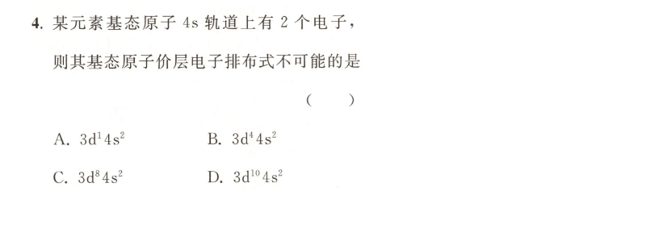

# 构造原理与电子排布式

- 学科：化学 / 章节：原子结构
- 状态：新
- 更新：2026-11-24

## 我会怎么错

按「填充顺序」写排布式，把 `4s` 写到 `3d` 前面去；忘了洪特规则，把 `2p³` 写成挤在一条轨道上；`Cr`、`Cu` 两个例外一考就掉；把「能层顺序」和「填充顺序」当成一回事。

## 正确怎么走

**第一步：填充顺序（块状背）**

```
1s ｜2s 2p ｜3s 3p ｜4s 3d 4p ｜5s 4d 5p ｜6s 4f 5d 6p ｜7s 5f 6d 7p
```

**第二步：三条规矩**

- 能量最低原理：先坐低台阶
- 泡利原理：一条轨道最多 2 个电子，自旋相反
- 洪特规则：同一能级的等价轨道，先各占一条、自旋同向，再配对（如 `2p³` 三个单电子）

**第三步：写排布式，按能层顺序写**

铁（26）：`1s² 2s² 2p⁶ 3s² 3p⁶ 3d⁶ 4s²`，简写 `[Ar]3d⁶4s²`。
注意 `3d` 写在 `4s` 前面，**填的时候先填 4s**，两个方向别搞反。

**第四步：两个例外背下来**

```
Cr（24）：[Ar]3d⁵ 4s¹
Cu（29）：[Ar]3d¹⁰ 4s¹
```

半满 `d⁵`、全满 `d¹⁰` 更稳，所以挪一个电子过去。

## 典型题

写出 26 号元素 Fe 的电子排布式，并说明 3d 上有几个电子。

答案：`[Ar]3d⁶4s²`，3d 上 6 个。

## 自测

- 背得出填充顺序的七块
- 写 K、Ca、Fe、Cu 的排布式
- 说得出 Cr、Cu 为什么要特例
- 说得出洪特规则跟泡利规则各自管什么

## 相关

- [返回章节](../README.md)
## 典型题 · 4s 上有 2 个电子的价层排布

题：某元素基态原子 `4s` 轨道上有 2 个电子，其价层电子排布式不可能的是

A. `3d¹4s²`　B. `3d⁴4s²`　C. `3d⁸4s²`　D. `3d¹⁰4s²`

**解法：把电子数加出来，反推元素，再看基态对不对。**

内层都是 `[Ar]` 那 18 个，所以：
- A：18+1+2 = 21 → Sc，基态正是 `3d¹4s²` ✔
- B：18+4+2 = 24 → Cr，但 Cr 基态是 **`3d⁵4s¹`**（半满更稳）✘
- C：18+8+2 = 28 → Ni，正是 `3d⁸4s²` ✔
- D：18+10+2 = 30 → Zn，正是 `3d¹⁰4s²` ✔

答案 **B**。


