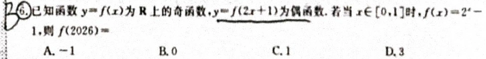
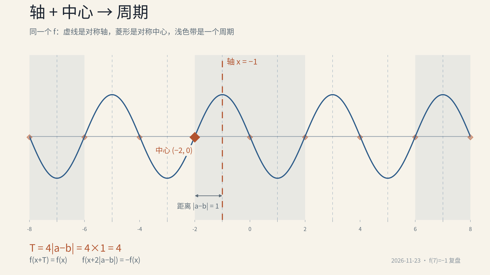

# 奇偶叠加推周期

- 学科：数学 / 章节：函数性质
- 状态：新
- 更新：2026-11-23

## 我会怎么错

看到 `f(2x+1)` 是偶函数，就以为 `f` 关于 x=0 对称；知道奇偶，但不知道下一步要干嘛；看见 `f(2026)` 这种大数就不敢动。

## 正确怎么走

**第一步：把奇偶翻译成对称**

- `f(x)` 是奇函数 → 图像关于原点 **中心对称**
- `f(x+a)` 是偶函数 → 图像关于直线 **x = a** 轴对称
- 所以 `f(2x+1)` 偶，令 `t=2x`，得 `f(1+t)=f(1−t)` → 轴是 **x = 1**

**第二步：两种不同的对称一叠加，必出周期**

- 轴 a + 中心 b → `T = 4|a−b|`
- 两条轴 a、b → `T = 2|a−b|`
- 两个中心 a、b → `T = 2|a−b|`

本题 a=1、b=0 → `T = 4`。

**第三步：看到「求 f(大数)」，就认定是周期题**

大数先对周期取余：`2026 = 4×506 + 2 → f(2026)=f(2)`。

**第四步：靠奇偶把点搬回已知区间**

`f(2) = −f(0) = 0`。

## 典型题

`f` 奇、`f(2x+1)` 偶、x∈[0,1] 时 `f(x)=2^x−1`，求 `f(2026)` → 轴 1、中心 0，`T=4`，余 2，`f(2)=−f(0)=0`。

## 自测

- `f` 奇、`f(x+2)` 偶 → 口算 `T=8`
- `f(x+1)`、`f(x−1)` 都偶 → 轴 1 与 −1，口算 `T=4`
- 说得出「为什么求大数就要找周期」

## 相关

- [返回章节](../README.md)

## 原题

## 图示

