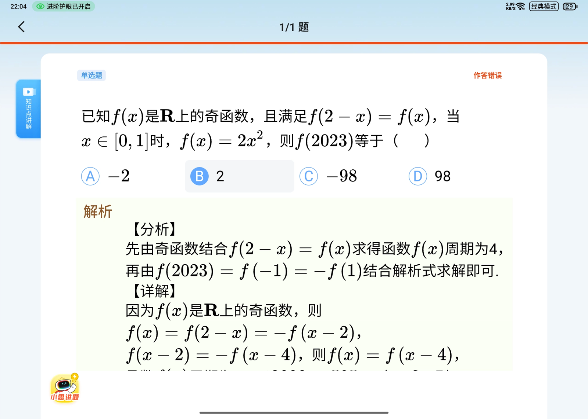

# 错题记录 · 奇偶叠加推周期

只追加，不删不改。这里只放做错的。

## 2026-11-23 · f(2026) 题

- 我的状态：不知道思路，问「这种真不知道思路」
- 正确：奇 → 原点中心对称；f(2x+1) 偶 → 轴 x=1；两者叠加 T=4；2026≡2 → f(2)=−f(0)=0
- 修正：奇偶先翻成对称，两种对称叠出周期

## 2026-11-23 · f(7) 两条件题 · 作答错误

- 题：f(2x−1) 偶、f(x−2) 奇、x∈[0,1] 时 f(x)=2^x−1，求 f(7)
- 正确：A（−1）
- 错在哪：两个条件都要对 x 做 −x 替换再整理，符号一乱就全错；核心仍是「轴 + 中心 → 周期 4」
- 走法：f(2x−1) 偶 → f(x)=f(−x−2)，轴 x=−1；f(x−2) 奇 → 中心 (−2,0)；T=4|−1−(−2)|=4；7≡3 → f(7)=f(3)=−f(1)=−1

## 2026-11-23 · f(2023) 奇 + 轴对称 · 作答错误

- 题：f 是 R 上奇函数，f(2−x)=f(x)，x∈[0,1] 时 f(x)=2x²，求 f(2023)
- 我选：B（2）｜正确：A（−2）
- 错在哪：周期 4 和取余 3 都算对了，最后「转半圈」忘了带负号，把 f(−1) 当成 f(1)
- 走法：奇 → 中心 (0,0)；f(2−x)=f(x)，x 与 2−x 的中点是 1 → 轴 x=1；T=4|1−0|=4；2023=4×505+3 → f(3)=f(−1)=−f(1)=−2×1²=−2
- 坑：f(2−x)=f(x) 是「关于 x=1 对称」，不是「周期 2」

