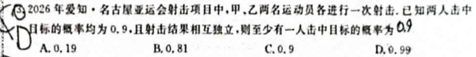
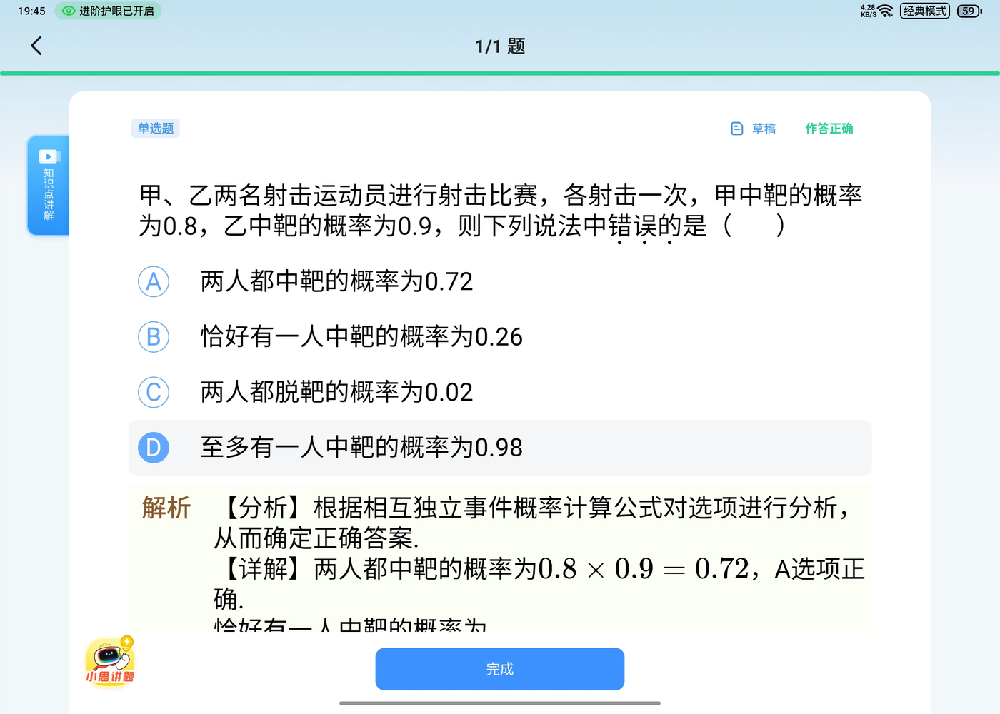
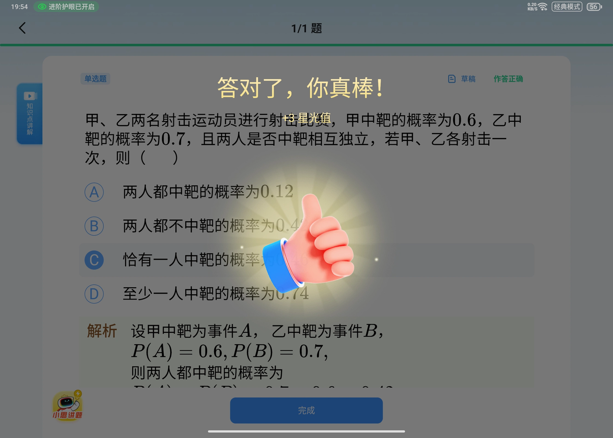

# 至少至多走对立

- 学科：数学 / 章节：概率
- 状态：新
- 更新：2026-11-23

## 我会怎么错

「至少一人命中」直接把两个概率相加，得 1.8 或 0.9。

## 正确怎么走

- 至少、至多、不全，一律走对立事件：`P = 1 − P(全都不)`
- 独立事件才可以相乘：`P(都不) = P(甲不)·P(乙不)`
- 至多一人 = 全都不 + 恰好一人

## 典型题

甲乙命中率各 0.9、独立，至少一人中：`1 − 0.1×0.1 = 0.99`，选 D。

## 自测

独立、各 0.8：至少一人 30 秒内报 0.96。

## 相关

- [../独立与互斥别混/](../独立与互斥别混/)
- [返回章节](../README.md)

## 三种问法的对照（2026-11-23 补）

设甲中 0.8、乙中 0.9、独立。

| 问法 | 意思 | 算式 | 本题 |
|---|---|---|---|
| 至少一人中 | 有一个就算，两个都中也算 | 1 − 都不中 | 1 − 0.02 = 0.98 |
| 至多一人中 | 两个都中就不行 | 1 − 都中 | 1 − 0.72 = 0.28 |
| 恰好一人中 | 只许一个中，另一个不中 | 甲中乙不中 + 乙中甲不中 | 0.08 + 0.18 = 0.26 |

速验：恰好一人 = 至多一人 − 都不中 = 0.28 − 0.02 = 0.26；也等于 至少一人 − 都中 = 0.98 − 0.72 = 0.26。

## 原题

