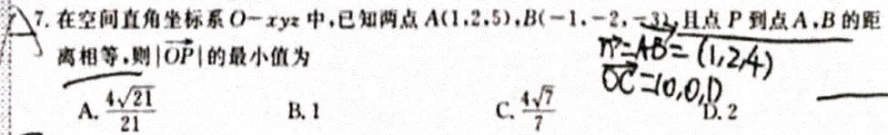

# 垂直平分面与点面距离

- 学科：数学 / 章节：空间向量
- 状态：新
- 更新：2026-11-23

## 我会怎么错

看到「点 P 到 A、B 距离相等」，第一反应是设 `P(x, y, z)`，写两个平方差再硬算；或者把 `AB` 当成平面里的一条线，忘了它是**法向量**的方向。

## 正确怎么走

**第一步：把「距离相等」翻译成一张平面**

`|PA| = |PB|` 说明 P 被赶到 AB 的**垂直平分面**上。先取中点 M：

```
M = ((xA+xB)/2, (yA+yB)/2, (zA+zB)/2)
```

**第二步：法向量就是 AB 的方向**

```
n = (x_B - x_A, y_B - y_A, z_B - z_A)   （可以整体约掉公因数）
```

**第三步：写平面方程**

```
n·(X - M) = 0
```

**第四步：|OP| 最小 = 原点到这张平面的距离**

```
d = |n·M| / |n|      （平面过 M，法向量 n）
```

分母记得开干净，`√21` 不能写成 `√7`。

## 典型题

A(1, 2, 5)，B(−1, −2, −3)，`|PA| = |PB|`，求 `|OP|` 的最小值。

- 中点 M = (0, 0, 1)（正好在 z 轴上，这是题目的钩子）
- n = (1, 2, 4)
- 平面：`x + 2y + 4z = 4`
- `d = 4 / √21 = 4√21 / 21` → 选 A

## 自测

- 不看笔记，说得出「距离相等 → 垂直平分面 → 原点到平面距离」这三步
- 能一眼看出中点是不是落在坐标轴上
- 分母开根不会漏系数

## 相关

- [返回章节](../README.md)

## 原题


