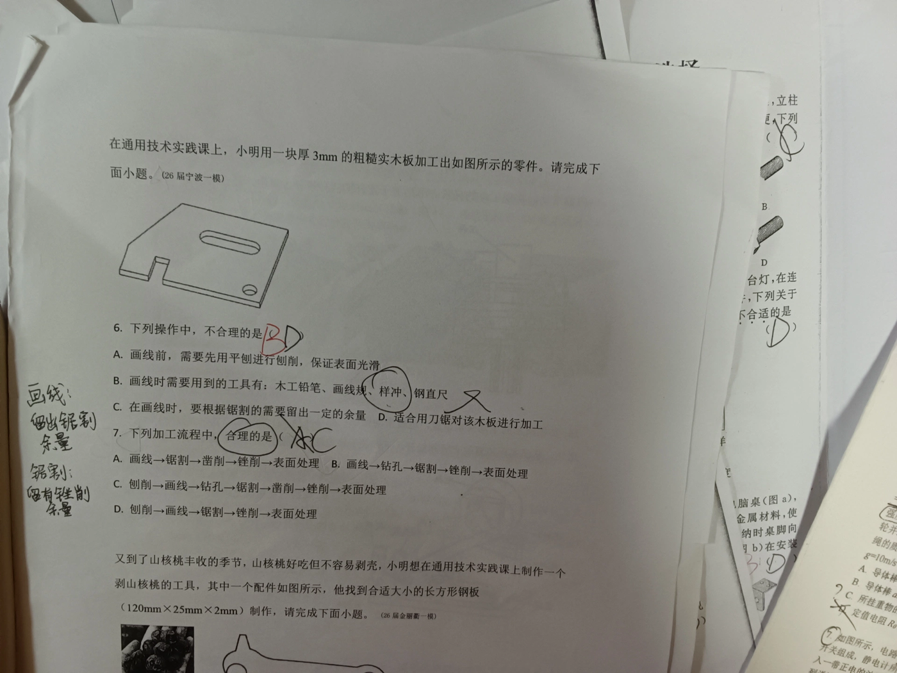

# 工序排序三问法

- 学科：通用技术 / 章节：加工流程
- 状态：高频
- 更新：2026-11-23

## 我会怎么错

背顺序，遇到新零件就乱排。

## 正确怎么走

四段式：**备料定型 → 成形 → 精修 → 表面处理**。

排顺序时问三句：

1. 这道工序需要什么前提？画线要平面，锯槽要孔，攻丝要底孔。
2. 会不会破坏后面要用的东西？刨削会刨掉画好的线，上漆会盖住表面。
3. 做完它，工件会不会变小、变难夹？会就往前排。

## 典型题

3mm 粗糙实木板做带长条孔的零件：A 缺刨削和钻孔、B 缺刨削和凿削、D 缺钻孔和凿削，只有 C 全。

## 自测

给一个带孔带槽的陌生零件，当场说出流程，并解释每一步为什么排在那。

## 相关

- [../木工与金工标准流程/](../木工与金工标准流程/)
- [返回章节](../README.md)

## 原题

